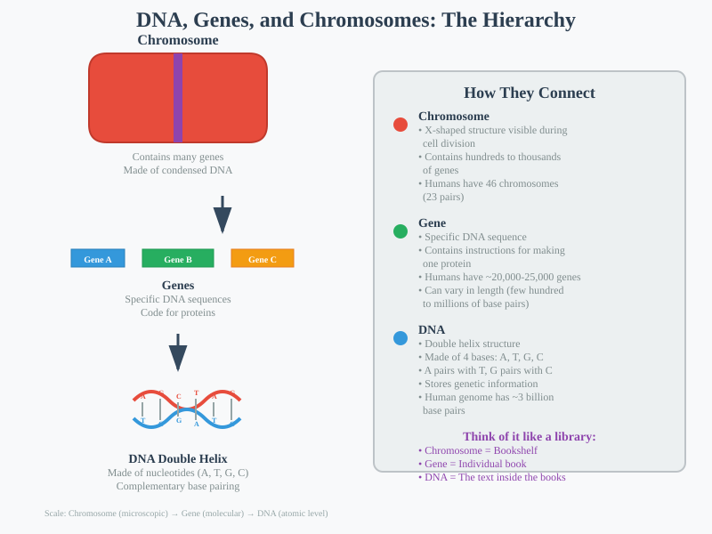

- human boday has 13 trillion cells
- every cell contains 23 pairs of chromosomes - 23 from each parent.
- human body contains 20k - 25k genes

relationship between dna, gene and chromosome: 

each DNA is made of ATGC

## DNA Nucleotide Bases

A (Adenine) - $\large \text{C}_5\text{H}_5\text{N}_5$

T (Thymine) - $\large \text{C}_5\text{H}_6\text{N}_2\text{O}_2$

G (Guanine) - $\large \text{C}_5\text{H}_5\text{N}_5\text{O}$

C (Cytosine) - $\large \text{C}_4\text{H}_5\text{N}_3\text{O}$

- human boday has 13 trillion cells
- every cell contains 23 paris of chromosomes - 23 from each parent.
- human body contains 20k - 25k genes

relationship between dna, gene and chromosome: 

each DNA is made of ATGC

## DNA Nucleotide Bases

- **A (Adenine)** - C₅H₅N₅
- **T (Thymine)** - C₅H₆N₂O₂  
- **G (Guanine)** - C₅H₅N₅O
- **C (Cytosine)** - C₄H₅N₃O 

Question - 
is Adenine(A) found in all humans same? 
- Adenine molecule itself is identical in all humans, every adenine molecule has same cheminal formula.
- But the sequence of where this A appears is different for each human.
- All humans have 99.9% of DNA as same
- 0.1% difference or the 3 million base pairs.

Question - if a child gets 23 chromosomes from each parent, then is the dna identical? 

Question - 
is Adenine(A) found in all humans same? 
- Adenine molecule itself is identical in all humans, every adenine molecule has same cheminal formula.
- But the sequence of where this A appears is different for each human.
- All humans have 99.9% of DNA as same
- 0.1% difference or the 3 million base pairs.

Question - if a child gets 23 chromosomes from each parent, then is the dna identical? 

Question - human cell types? 
size of oxygen atom -> 0.66 Angstorms (Angstorm=10**-10)
200-300 different cell types exist in human body? 
in general cell has membrane, dna inside, reproduce and homeostatis

Question - what is element composition of the human body?

Question - what defines a skin color? 

Question - Twins? types? what is common? 

Question - 

